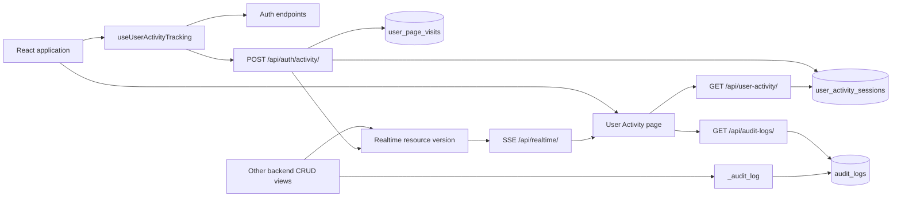

# User Activity Page — Technical Implementation Report

## 1. Scope and architecture

The feature has two related but separate concerns:

1. **User activity tracking**: records login sessions, page visits, page-view counts, time spent, current page, logout state, IP address, and user agent.
2. **Audit logging**: records business-data changes such as create/update/delete actions, the actor, request context, and before/after JSON.

The React page displays both datasets. Tracking runs globally for authenticated routes, so the activity page does not need to be opened for tracking to work.

Architecture:



## 2. Frontend entry points

### Route

- File: `frontend/src/router/config.tsx`
- The page is lazy-loaded as `UserActivityPage`.
- Route: `/user-activity`.

### Global activation

- File: `frontend/src/router/index.ts`
- `useUserActivityTracking()` is called once by `AppRoutes`, which is above all page routes.
- Tracking is enabled only when:
  - a cached authenticated user exists;
  - the route is not under `/login`;
  - `VITE_ENABLE_ACTIVITY_TRACKING !== 'false'`.
- Realtime updates are enabled similarly using `VITE_ENABLE_REALTIME`.

This placement is the key reusable design: route changes are observed centrally, so every page is tracked consistently.

### Navigation visibility

- File: `frontend/src/components/feature/TopNav.tsx`
- The User Activity link is added only when `adminAccess || itAccess`.
- The navigation check is a UI convenience; it is not a sufficient API security boundary.

### Page authorization

- File: `frontend/src/pages/user-activity/page.tsx`
- It calls `useAccessControl()`.
- `canView = access.adminAccess || access.itAccess`.
- If false, the page renders a permission message and does not load either dataset.
- Access is initially derived from local storage and refreshed from `/api/auth/access/`.

## 3. Authentication and activity-session creation

### Login

- Password login: `POST /api/auth/login/`.
- Microsoft login callback also creates an activity session.
- Backend helper: `_create_activity_session()` in `backend/login/views.py`.

A new `UserActivitySession` is created with:

- UUID `tracking_session_id`;
- database user ID;
- username, email, display name;
- auth provider;
- `login_at` and `last_seen_at`;
- client IP;
- user agent.

The login response includes:

```json
{
  "trackingSessionId": "uuid",
  "activitySessionId": 123
}
```

The complete user object, including this tracking ID, is stored in local storage under `kbc-auth-user`.

### Existing authenticated browser session

If a user is already stored but has no `trackingSessionId`, the tracker calls:

```
POST /api/auth/activity/start/
```

The backend resolves the user from ID, email, or username, creates a session, and returns the tracking identifiers. This handles deployments where tracking was added after users had already logged in.

### Session identity

The browser sends the UUID on every tracking request. The server looks up the session by UUID. The UUID is unique and is the stable identifier used across page changes.

## 4. Browser tracking algorithm

File: `frontend/src/hooks/useUserActivityTracking.ts`.

### 4.1 Current route state

The hook stores:

- `currentPathRef`: pathname plus query string plus hash;
- `enteredAtRef`: timestamp when the current route was entered or tracking resumed;
- `activeRef`: whether the tab is visible;
- refs preventing duplicate session-start requests.

### 4.2 API-header enrichment

When enabled, the hook temporarily wraps `window.fetch`.

For every URL containing `/api/`, it adds:

- `X-KBC-User-Id`;
- `X-KBC-User-Email`;
- `X-KBC-Username`;
- `X-KBC-Display-Name`;
- `X-KBC-Tracking-Session-Id`.

This makes actor context available to backend audit logging. The wrapper is restored on cleanup.

### 4.3 Page-view event

On initial route load and every React Router location change:

1. Ensure a tracking session exists.
2. Flush the previous route as `page_exit` if the path changed.
3. Set the new path and reset the entry timestamp.
4. POST a `page_view` event.

Payload shape:

```json
{
  "action": "page_view",
  "trackingSessionId": "uuid",
  "userId": 42,
  "email": "user@example.com",
  "username": "user",
  "path": "/events?id=7",
  "title": "Events",
  "durationSeconds": 0
}
```

The full path is retained, so query/hash changes are distinguishable.

### 4.4 Heartbeat

Every 30 seconds while the document is visible, the hook sends:

```json
{ "action": "heartbeat", "durationSeconds": 30, "...": "current page context" }
```

The duration is calculated in the browser from the current route entry timestamp. The backend also calculates elapsed server time since the last visit update and uses the larger value, limiting each reported interval to 3600 seconds.

### 4.5 Visibility changes

- When the tab becomes hidden:
  - send a forced `page_exit` through `navigator.sendBeacon`;
  - mark tracking inactive.
- When visible again:
  - send a forced heartbeat;
  - reset the entry timestamp.
- `beforeunload` and `pagehide` send a beacon `page_exit`.
- Hook cleanup also sends a beacon `page_exit`.

Beacon is used because ordinary fetch requests can be cancelled during navigation/unload.

### 4.6 Logout

TopNav sends `POST /api/auth/logout/` with the tracking UUID and reason `logout_button`.

It prefers `navigator.sendBeacon`, then falls back to keepalive fetch. The server sets `logout_at`, `logout_reason`, and updates totals.

## 5. Backend tracking endpoints

Routes are in `backend/login/urls.py`.

### `POST /api/auth/activity/start/`

Purpose: create a session for a pre-authenticated browser that has no tracking ID.

Behavior:

1. Parse JSON.
2. Reuse the supplied tracking session if it already exists.
3. Resolve an active login user by ID, email, or username.
4. Create a session.
5. Emit realtime resource changes.
6. Return tracking IDs.

### `POST /api/auth/activity/`

Purpose: record page views, heartbeats, page exits, and logout events.

Behavior:

1. Resolve the session by UUID.
2. Normalize action, path, title, and duration.
3. Find or create the page-visit row using the unique pair `(session, path)`.
4. For an existing visit:
   - update title and last-seen time;
   - add duration;
   - increment `view_count` only for `page_view`.
5. Recalculate session totals.
6. If action is `logout`, close the session.
7. Emit realtime resource changes.
8. Return updated `totalSeconds` and `pageCount`.

Duration is bounded to 0–3600 seconds per request.

### `POST /api/auth/logout/`

Closes a session from the explicit logout control. It is also tolerant of missing/invalid JSON and returns a successful logout response even if no matching session is found.

### Session total calculation

`_sync_session_totals()`:

- `total_seconds = SUM(page_visits.duration_seconds)`;
- `page_count = COUNT(page_visits)`;
- `last_seen_at = now`.

Therefore session totals are derived from page visits rather than incremented blindly.

## 6. Database schema

### `user_activity_sessions`

Django model: `UserActivitySession`.

Columns:

- `id`: bigint primary key;
- `tracking_session_id`: unique UUID;
- `user_id`: nullable login database user ID;
- `username`, `email`, `display_name`;
- `auth_provider`;
- `login_at`, nullable `logout_at`, `last_seen_at`;
- `total_seconds`, `page_count`;
- `ip_address`, `user_agent`, `logout_reason`;
- `created_at`, `updated_at`.

Indexes support user and time lookups.

### `user_page_visits`

Django model: `UserPageVisit`.

Columns:

- `id`;
- foreign key `session`;
- `path`, `title`;
- `first_seen_at`, `last_seen_at`;
- `duration_seconds`, `view_count`;
- timestamps.

Constraint: one row per session/path using `unique_together = ('session', 'path')`.

### Active-session rule

Backend constant:

```python
ACTIVITY_ACTIVE_WINDOW_SECONDS = 60
```

A session is active only when:

- `logout_at IS NULL`; and
- `last_seen_at >= now - 60 seconds`.

This means a user can be shown as inactive after one minute without a heartbeat even if they did not explicitly log out.

## 7. Read APIs used by the page

### `GET /api/user-activity/`

Query parameters:

- `search`: email, username, display name, or visited path;
- `from`, `to`: dates applied to `last_seen_at`;
- `status`: `all`, `active`, or `completed`;
- `page`, `pageSize`: server pagination.

Default page size is 25, capped at 100 by this endpoint.

Response:

```json
{
  "summary": {
    "totalSessions": 0,
    "returnedSessions": 0,
    "matchingSessions": 0,
    "activeSessions": 0,
    "completedSessions": 0,
    "uniqueUsers": 0,
    "totalSeconds": 0,
    "totalPageViews": 0
  },
  "pagination": {
    "page": 1,
    "pageSize": 10,
    "totalItems": 0,
    "totalPages": 1,
    "returnedItems": 0,
    "hasNext": false,
    "hasPrevious": false
  },
  "sessions": []
}
```

Each session includes nested page visits and a computed `currentPage`.

Server-side filtering and pagination happen before serialization. The page calculates visual sorting/grouping over the returned page.

### `GET /api/audit-logs/`

Query parameters:

- `search`: actor, entity, object label, or request path;
- `entity`;
- `action`;
- `from`, `to`;
- `page`, `pageSize`.

The response contains paginated logs with:

- action/entity/object identity;
- actor;
- route and HTTP method;
- IP address;
- `before`, `after`, and `metadata` JSON;
- creation timestamp.

## 8. Audit-log production

Backend helper: `_audit_log()` in `backend/api/views.py`.

CRUD handlers call it after successful changes, for example:

```python
_audit_log(
    request,
    action='update',
    entity='Event',
    object_id=event.id,
    object_label=event.title,
    before=before_snapshot,
    after=after_snapshot,
    metadata={...},
)
```

The helper captures:

- actor headers;
- request path and method;
- client IP and user agent;
- before/after snapshots;
- arbitrary metadata.

It catches all exceptions so audit failure does not break the primary user operation. It emits realtime resource changes after the transaction commits.

## 9. Page data flow and state

File: `frontend/src/pages/user-activity/page.tsx`.

Important state:

- activity and audit payloads;
- loading/error states for each API;
- search and date filters;
- session filter;
- session/audit page numbers;
- session, page-visit, and audit sort settings;
- expanded session and audit IDs;
- open audit-day groups;
- realtime mode;
- lazily loaded KSB profiles and training-plan rows.

Query construction is memoized. Changing search/date filters resets both pagers; changing session status resets the session pager.

Two independent effects load activity and audit logs with:

- `AbortController`;
- an in-flight guard;
- stale-response protection;
- no-store activity requests;
- focus and visibility refresh.

## 10. UI behavior

The page renders:

1. Top navigation and breadcrumb.
2. Permission message for unauthorized users.
3. Summary cards:
   - sessions;
   - unique users;
   - returned sessions;
   - total period.
4. Search/date/status controls and reset button.
5. Session table grouped by day.
6. Sortable columns for user, login, status, time, and pages.
7. Expandable sessions with nested page visits.
8. Page-visit sorting by page, duration, views, or last seen.
9. Pagination controls.
10. Audit-log table grouped by day.
11. Expandable audit details.
12. Specialized audit renderers for:
    - TrainingPlan;
    - ModuleLearnerMapping;
    - Module;
    - generic entities.
13. Summary modals for session/user/time breakdowns.
14. Footer.

Date grouping is local-time based and labels groups as Today, Yesterday, or a formatted date.

## 11. Realtime refresh

Backend realtime state is a cache counter per resource. Tracking changes signal:

- `user_activity`;
- `activity`;
- `auth_activity`;
- `page_visits`.

Audit changes signal:

- `audit_logs`;
- `audit`.

Frontend `useRealtimeUpdates`:

1. waits five seconds;
2. attempts `EventSource('/api/realtime/?stream=1')`;
3. compares resource versions;
4. dispatches a browser custom event;
5. falls back to polling every 60 seconds if SSE fails;
6. retries SSE after 60 seconds.

The page subscribes only to activity or audit resource names it needs. Refetches are debounced by one second, and hidden tabs do not refetch.

## 12. Lazy audit enrichment

The initial page load does not fetch all supporting datasets.

- Expanding a `TrainingPlan` audit entry fetches `/api/ksb-profiles/?includeInactive=1` once.
- Expanding a `ModuleLearnerMapping` entry fetches `/api/training-plan/` once.
- Failed lazy loads reset their fetched flag so a later expansion can retry.

This avoids expensive requests when the user never opens a detailed log.

## 13. Reusable implementation blueprint

For a different project, implement in this order:

1. Create a server-side activity session table.
2. Create a child page-visit table with a unique session/path key.
3. Create an audit-log table with before/after JSON.
4. Generate a random tracking-session UUID at login.
5. Persist the UUID in the authenticated client context.
6. Put a single activity hook/provider above the router.
7. Emit `page_view` on route changes.
8. Emit heartbeats while visible.
9. Flush on hidden, pagehide, beforeunload, and logout.
10. Recompute session totals from page visits.
11. Build paginated read endpoints.
12. Add server-side filters and an active-window rule.
13. Instrument all mutating handlers with one audit helper.
14. Add SSE or polling invalidation.
15. Build the admin page as a consumer of those APIs.
16. Add lazy loading for expensive detail context.
17. Add tests for duplicate page views, route changes, hidden tabs, logout, stale sessions, pagination, and audit snapshots.

## 14. Important risks and improvements before copying

1. **Server authorization**: in this repository, `user_activity` and `audit_logs` are plain GET views and the page-level permission check is client-side. In a new project, enforce admin/IT authorization in the backend before returning sensitive activity, IP, user-agent, or audit data.
2. **Trusting client headers**: the audit helper reads actor identity from `X-KBC-*` headers. A browser can forge these headers. Prefer server-side authenticated identity, signed tokens, or a server session.
3. **Privacy and retention**: define retention, access logging, masking, and legal basis for IP addresses, user agents, and employee activity.
4. **Multiple tabs**: each login/browser context shares the same tracking ID if local storage is reused. Use session storage or a tab-specific ID if tabs must be separate.
5. **Duration accuracy**: browser timing and beacon delivery are best-effort. Treat time as an estimate, and consider server-side event timestamps for stronger accuracy.
6. **SSE scale**: cache counters are simple but do not replace a durable event bus for many servers or high event volume.
7. **Audit transaction semantics**: audit writes should be in the same transaction as the business mutation when an immutable record is required. The current helper intentionally swallows audit errors.
8. **Pagination and sorting**: server pagination happens before the page's visual sort. If users expect global sorting across all records, move sort fields into API query parameters.
9. **Active timeout**: choose the heartbeat interval and active cutoff together. Here, heartbeat is 30 seconds and active cutoff is 60 seconds.
10. **Path cardinality**: storing full query strings can create many paths. Normalize or redact sensitive query parameters in a production design.
11. **Idempotency**: pagehide, cleanup, and visibility events can overlap. The endpoint should tolerate duplicate exits and duration reports.
12. **Database performance**: add indexes for the exact filters and time ranges used by the admin page; consider pre-aggregated daily statistics at scale.

## 15. Source map

- Page: `frontend/src/pages/user-activity/page.tsx`
- Global tracker: `frontend/src/hooks/useUserActivityTracking.ts`
- Router integration: `frontend/src/router/index.ts`
- Route declaration: `frontend/src/router/config.tsx`
- Realtime client: `frontend/src/hooks/useRealtimeUpdates.ts`
- Session models: `backend/api/models.py`
- Session migrations: `backend/api/migrations/0014_user_activity_tracking.py`
- Audit model/migration: `backend/api/models.py`, `backend/api/migrations/0015_audit_logs.py`
- Tracking/auth endpoints: `backend/login/views.py`, `backend/login/urls.py`
- Read APIs and serializers: `backend/api/views.py`, `backend/api/urls.py`
- Realtime backend: `backend/api/realtime.py`

